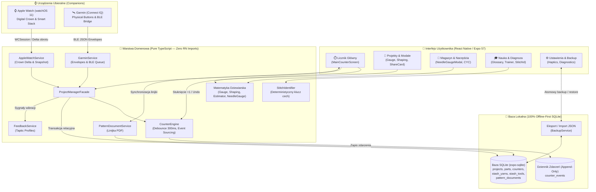

# Oczko (Purlo) 🧶⏱️

[](https://www.apple.com/ios/)
[](https://www.apple.com/watchos/)
[](https://developer.garmin.com/connect-iq/)
[](https://expo.dev/)
[](https://reactnative.dev/)
[](https://www.typescriptlang.org/)
[](https://sqlite.org/)
[](docs/decyzje_biezace.md)
[-brightgreen?style=flat)](docs/decyzje_biezace.md)
[](https://github.com/lkarwowski494/Oczko/actions)

> **„Precyzyjny, wolny od rozpraszaczy licznik rzędów i asystent dziewiarski stworzony dla dziewiarek i dziewiarzy — zawsze z Tobą, na iPhone, Apple Watch i Garminie.”**

Aplikacja mobilna na systemy **iOS 18+**, **watchOS 11+** oraz smartwatche **Garmin Connect IQ**, dedykowana pasjonatom dziewiarstwa i szydełkowania. Zbudowana w bezkompromisowej architekturze **100% Offline-First** na bazie lokalnego silnika SQLite i niezmiennego dziennika zdarzeń (Event Sourcing). Integruje precyzyjny, chroniony przed przypadkowymi stuknięciami licznik rzędów z obsługą warkoczy i ażurów, wbudowany czytnik wzorów PDF ze zsynchronizowaną pływającą linijką postępu, pełne asystenty smartwatchowe (Apple Watch z obsługą fizycznej Cyfrowej Koronki *Digital Crown* oraz Garmin z obsługą przycisków fizycznych i BLE), magazyn włóczek z kontrolą partii farbowania (*Dye Lot*), trenażer ściegów, wizualny identyfikator ściegu „Co widzisz?”, miarkę rozmiarów drutów oraz zaawansowane kalkulatory dziewiarskie (próbka ściegu, kształtowanie oczek, estymator zużycia włóczki).

---

## 🌟 Główne Zasady Produktowe & Architektura

- **100% Offline-First (Lokalne SQLite & Event-Sourcing):** Wszystkie widoki aplikacji czytają i modyfikują stan wyłącznie w lokalnej bazie danych SQLite (`expo-sqlite`, `src/core/database.ts`). Każde naliczenie rzędu (`+1`, `-1`) rejestrowane jest jako niezmienne zdarzenie czasowe w tabeli `counter_events`. Stan robótki odtwarzany jest deterministycznie z historii zdarzeń. Zero opóźnień sieciowych, zerowy czas reakcji interfejsu ($< 16\,\text{ms}$).
- **Niezależny Companion Apple Watch & Smart Stack (DEC-03, BR-ZEG-003, BR-ZEG-009):** Pełna integracja z zegarkami Apple Watch. Zliczanie rzędów za pomocą wielkiego, dotykowego przycisku `+1 Rząd` (idealnego do stuknięcia bez odkładania drutów), fizycznej Cyfrowej Koronki (*Digital Crown*) z progiem czułości oraz wibracji haptycznych Taptic Engine. Widżety Smart Stack i Live Activities na bieżąco prezentują aktualny rząd i postęp robótki na ekranie blokady iOS 18.
- **Protokół Garmin Connect IQ Companion & BLE Bridge (DEC-02):** Dedykowany protokół komunikacyjny BLE JSON (`GARMIN_COMM_UUID`) z kopertami wiadomości (`HANDSHAKE`, `SYNC_STATE`, `WATCH_EVENT`, `ACK`, `NACK`), mapowaniem fizycznych przycisków bezela (`START-STOP` / `LAP` / `UP` / `DOWN`), buforem offline `GarminOfflineQueue` i interaktywnym symulatorem zegarka 47 mm (AMOLED/MIP).
- **Ochrona przed Przypadkowym Liczeniem (Debounce BR-LICZ-007):** Deterministyczny bufor czasowy ($300\,\text{ms}$) ignorujący przypadkowe, podwójne stuknięcia ekranu lub drgania dłoni podczas intensywnego dziergania, co gwarantuje bezwzględną nienaruszalność licznika rzędów.
- **Wzory PDF z Pływającą Linijką Postępu (DEC-09, BR-WZOR-001, NFR-DOST-009):** Czytnik dokumentów PDF ze zsynchronizowaną, pływającą linijką optyczną (`ruler_y_percent`), która automatycznie przesuwa się w dół wraz z każdym kolejnym rzędem i automatycznie przełącza strony po osiągnięciu dolnego marginesu. Spełnia wyśrubowane normy dostępności cyfrowej dla osób słabowidzących (WCAG AAA).
- **Standaryzacja Craft Yarn Council (CYC) & Słownik Wielojęzyczny (DEC-07, DEC-18, DEC-24):** Matematyka dziewiarska, grubości włóczek (CYC 0–6: Lace, Fingering, Sport, DK, Worsted, Aran, Bulky, Super Bulky) oraz symbole diagramów oparte są o międzynarodowe normy branżowe. Słownik terminologii oferuje natychmiastowe tłumaczenia skrótów dziewiarskich (PL, EN-US, EN-UK, DE, FR) z własnymi glifami wektorowymi.
- **Magazyn Włóczek & Narzędzi ze Śledzeniem Partii Farbowania (Dye Lot, BR-MAG-001 - 005):** Ewidencja zasobów dziewiarki z rozbiciem na składy surowcowe (Merino, Alpaka, Bawełna, Jedwab, Mohair, Len, Syntetyki), gramaturę, metraż oraz kluczowy dla odcieni dzianiny numer partii farbowania (*Dye Lot*).
- **Deterministyczna Matematyka Dziewiarska bez Generatywnego AI (Inwariant ZP-05):** Zero halucynacji i zero generatywnego AI w logice produktu. Wszystkie algorytmy (drzewo decyzyjne identyfikacji ściegu DEC-16, euklidesowe kształtowanie oczek, kalkulator próbek, estymator zużycia, miarka drutów) opierają się na ścisłych regułach matematycznych.
- **Pojedyncze Źródło Prawdy & Czysta Architektura Domenowa:** Cała logika obliczeniowa i biznesowa (`src/core/`) jest całkowicie odizolowana od komponentów React Native i bibliotek widokowych. Umożliwia to wykonywanie pełnych testów jednostkowych i integracyjnych bez potrzeby uruchamiania emulatora.

---

## 📱 Moduły i Ekrany

1. **⏱️ Główny Licznik Rzędów & Tryby Pracy (`MainCounterScreen` / `app/(tabs)/index.tsx`):**
   - Wielka, wolna od zbędnych rozpraszaczy karta dotykowa `+1 Rząd` z czytelnym podglądem numeru rzędu.
   - Przycisk natychmiastowego wycofania błędnego kliknięcia `Cofnij (Undo)` z dedykowaną haptyką powrotną.
   - Płynny przełącznik trzech widoków roboczych: `🔢 Licznik`, `📜 Schemat & Linijka`, `📑 Wzór PDF`.
   - Poziomy pasek wyboru części robótki (np. Korpus, Rękaw lewy, Rękaw prawy) z celami rzędów (`targetRows`).
   - Szybkie przypomnienia cykliczne (co 4, 6, 8, 10, 12 rzędów lub wartość własna) z wibracją i etykietą zadania (np. „Dodaj oczko na brzegu”, „Zmiana splotu”).
   - Dedykowane chipy smartwatchy: `⌚ Apple Watch` oraz `🛰️ Garmin` z podglądem stanu i dwukierunkową synchronizacją.
2. **🪢 Liczniki Powiązane (Linked Counters — Warkocze & Ażury):**
   - Równoległe, automatyczne zliczanie rzędów powtórzeń motywów (np. warkocz C6F o cyklu 6 rzędów).
   - Osobne modulo-cykle i alerty operacji w wyznaczonym rzędzie cyklu powtórzenia (np. `Rząd 4/6 (Powt. 2)`).
   - Transakcyjne, synchroniczne wycofywanie (UNDO) kroku nadrzędnego wraz z powiązanymi krokami podrzędnymi w pojedynczej operacji SQLite.
3. **⌚ Apple Watch Companion & Live Activities (`DEC-03`, `DEC-08`, `BR-SYS-003`, `AppleWatchCompanionModal`):**
   - Zoptymalizowany ekran zegarka (OLED 45 mm) z natychmiastowym feedbackiem haptycznym.
   - Obsługa fizycznego obrotu Cyfrowej Koronki (`Digital Crown`) z akumulatorem delty i progiem czułości.
   - Kursorowe zrzuty stanu (`WatchCounterSnapshot`) dla widżetów Smart Stack i Live Activities na ekranie blokady iOS 18.
   - Bufor offline `WatchOfflineQueue` zabezpieczający naliczenia przy chwilowym braku łączności Bluetooth z telefonem.
4. **🛰️ Garmin Connect IQ Companion & Symulator Zegarka (`DEC-02`, `GarminCompanionModal`):**
   - Realistyczny symulator okrągłego zegarka Garmin (47 mm) z obsługą ekranów AMOLED / MIP.
   - Fizyczne przyciski bezela: `START-STOP` (+1 Rząd), `BACK-LAP` (Cofnij), `UP-MENU` (Poprzednia część), `DOWN` (Następna część).
   - Protokół ConnectIQ Mobile SDK JSON z identyfikatorem `GARMIN_COMM_UUID` i kopertami wiadomości.
   - Przełącznik trybu Offline (`🔌 Rozłącz BLE / Połącz`) z buforowaniem operacji w `GarminOfflineQueue`.
5. **📑 Wzór PDF z Ruchomą Linijką Postępu (`DEC-09`, `BR-WZOR-001`, `NFR-DOST-009`, `PatternPdfViewer`):**
   - Import plików PDF oraz schematów graficznych za pośrednictwem natywnego selektora plików (`expo-document-picker`).
   - Pływająca linijka optyczna z regulacją wysokości i trybem wysokiego kontrastu dla czytelności drobnego druku.
   - Funkcja `Auto-krok` automatycznie przesuwająca linię czytania o zadany skok wraz z każdym krokiem licznika.
6. **📜 Schematy & Diagramy Splotów (`PatternGuideViewer`):**
   - Interaktywny diagram splotu (np. warkocz C6F, ażur rombowy) z dynamicznym podświetlaniem aktywnego rzędu robótki.
   - Zintegrowana linijka śledząca oraz kompletna legenda symboli dziewiarskich Craft Yarn Council (CYC).
7. **📁 Zarządzanie Projektami (`app/(tabs)/projects.tsx`):**
   - Podział na robótki aktywne (WIP — *Work in Progress*) oraz ukończone (FO — *Finished Objects*).
   - Dynamiczny pasek postępu procentowego bazujący na zdefiniowanych częściach i liczbie rzędów docelowych.
   - Generator estetycznych wizytówek rzemieślniczych (`ProjectShareCardModal`) do udostępniania w mediach społecznościowych i na Ravelry.
8. **📐 Zaawansowane Kalkulatory Dziewiarskie:**
   - **Kalkulator Próbki Ściegu (`GaugeCalculatorModal`):** Wylicza wymaganą liczbę oczek do nabrania i docelowych rzędów na podstawie wymiarów próbki i gotowego wyrobu (cm/cale), analizuje naprężenie dzianiny (Tension check) i oferuje bazę gotowych szablonów projektowych (czapki, szale, swetry, kocyki, skarpetki).
   - **Kalkulator Kształtowania Oczek (`ShapingCalculatorModal`):** Euklidesowy algorytm symetrycznego i równomiernego dodawania (M1L, M1R, kfb, yo) lub odejmowania oczek (k2tog, ssk, p2tog) bez widocznych skupisk, ochrona brzegów (`edgeStitches`) oraz kształtowanie wielorzędowe (rękawy, raglany, dekolty) z optymalizacją pod rzędy prawe (RS).
   - **Estymator Zużycia Włóczki (`YarnUsageEstimatorModal`):** Dwa tryby obliczeń (w trakcie robótki na bazie zważonej części lub przed startem na bazie powierzchni i próbki), algorytm gry w cykora z włóczką (*Yarn Chicken*) ostrzegający przed deficytem, margines bezpieczeństwa oraz wskaźnik Yarn Grist (m/g).
9. **🧶 Magazyn Włóczek & Narzędzi (`app/(tabs)/stash.tsx`):**
   - Ewidencja włóczek: producent, nazwa, odcień, numer partii farbowania (`Dye Lot`), waga motka i metraż.
   - Ewidencja drutów i szydełek: rozmiar metryczny (mm) i US, długość żyłki, typ (proste, z żyłką, pończosznicze).
   - Inteligentny panel filtrów grubości CYC (0–6), tagi surowcowe (Merino, Alpaka, Bawełna, Jedwab, Syntetyki) oraz natychmiastowy agregator statystyk zasobów.
10. **📏 Miarka Rozmiarów Drutów i Przelicznik Jednostek (`NeedleGaugeModal`):**
    - Pełna tabela 22 standardów rozmiarów CYC/ISO (od 2.0 mm do 25.0 mm) z odpowiednikami Metric (mm), US, UK, JP i Crochet.
    - Cyfrowa suwmiarka z wyszukiwaniem najbliższego rozmiaru metrycznego.
    - Konwerter jednostek rzemieślniczych w czasie rzeczywistym: długość ($m \leftrightarrow yd$), waga ($g \leftrightarrow oz$), gęstość próbki ($10\,\text{cm} \leftrightarrow 4''$).
11. **🎓 Moduł Nauki & Trenażer Wzorów (`app/(tabs)/learn.tsx`):**
    - Wielojęzyczny słownik terminologii dziewiarskiej (PL, EN-US, EN-UK, DE, FR) z natychmiastową wyszukiwarką i glifami CYC.
    - Interaktywny trenażer powtórzeń wzorów krok po kroku z instrukcjami dla strony prawej (RS) i lewej (WS) oraz licznikiem powtórzeń w rzędzie.
12. **🔍 Wizualny Identyfikator Ściegu „Co widzisz?” (`DEC-16`, `stitch-identifier.ts`):**
    - Deterministyczny klucz diagnostyczny bez AI oparty na 3 cechach obserwowanych dzianiny: strukturze powierzchni (`surface_texture`), rewersie (`reversibility`) oraz krawędzi i elastyczności (`edge_and_stretch`).
    - Rozpoznawanie 8 fundamentalnych profili dziewiarskich i szydełkowych (dżersej, dżersej lewy, ścieg francuski, ściągacz, ścieg ryżowy, warkocz, ażur, splot szydełkowy) z poradami technologicznymi i bezpośrednim linkiem do trenażera.
13. **⚙️ Ustawienia, Haptyka, Kopia i Bezpieczeństwo (`app/(tabs)/settings.tsx`):**
    - Panel konfiguracji haptyki Taptic Engine z możliwością odsłuchania na żywo każdego profilu (`step`, `undo`, `cycle`, `goal`, `reminder`).
    - Pełna kopia zapasowa danych do pliku JSON z weryfikacją spójności schematu, podglądem błędów walidacji i bezpiecznym przywracaniem.
    - Diagnostyka bazy danych SQLite, liczniki rekordów w czasie rzeczywistym oraz monitorowanie stanu połączeń zegarków Apple Watch i Garmin.

---

## 🔄 Architektura Przepływu Danych & Zdarzeń



### Gwarancje Architektoniczne i Biznesowe

| Obszar | Mechanizm w kodzie | Gwarancja biznesowa |
|---|---|---|
| **Zapis i odczyt stanu** | `expo-sqlite`, `src/core/database.ts` | 100% Offline-First, czas odpowiedzi interfejsu $< 16\,\text{ms}$, brak blokad sieciowych |
| **Ochrona liczenia (Debounce)** | `src/core/counter-engine.ts`, `BR-LICZ-007` | Ignorowanie drgań dłoni i wielokrotnych stuknięć $< 300\,\text{ms}$ |
| **Historia i cofanie (Undo)** | Tabela `counter_events`, Event Sourcing | Precyzyjne cofanie kroków i powiązanych liczników bez utraty spójności |
| **Apple Watch Companion** | `src/core/apple-watch-service.ts`, `DEC-03` | Niezależne liczenie na nadgarstku, bufor offline, obsługa Digital Crown |
| **Garmin Companion** | `src/core/garmin-service.ts`, `DEC-02` | Obsługa protokołu Connect IQ BLE, przyciski bezela, dedykowana kolejka offline |
| **Linijka postępu PDF** | `src/core/pattern-document-service.ts`, `DEC-09` | Pływająca linijka optyczna, auto-krok przy naliczaniu, przejścia stron |
| **Kształtowanie oczek** | `src/core/shaping-calculator.ts` | Równomierne i symetryczne rozmieszczanie modyfikacji oczek algorytmem euklidesowym |
| **Identyfikacja ściegu** | `src/core/stitch-identifier.ts`, `DEC-16` | 100% deterministyczny klucz cech obserwowanych bez użycia AI (Inwariant ZP-05) |
| **Miarka i konwersja jednostek** | `src/core/needle-gauge-converter.ts` | 22 rozmiary CYC/ISO (Metric, US, UK, JP) i bezstratna konwersja miar rzemieślniczych |
| **Powiadomienia cykliczne & Haptyka** | `src/core/feedback-service.ts`, `BR-SYS-011` | Dedykowane profile Taptic Engine (`step`, `undo`, `cycle`, `goal`, `reminder`) |
| **Bezpieczeństwo kopii zapasowej** | `src/core/backup-service.ts`, `DEC-10` | Pełny eksport relacyjny do JSON, ścisła walidacja schematu i atomowe przywracanie |

---

## 🧪 9 Warstw Rygoru Jakościowego (Testing Rigor & DoD)

Projekt realizowany jest zgodnie ze ścisłą definicją ukończenia (DoD) wzorowaną na standardzie repozytorium [organizer](https://github.com/lkarwowski494/organizer):

1. **100.00% Pokrycia Linii Kodu (100% Lines Coverage, ZAS-QA-01):** Bezwzględny wymóg pełnego pokrycia testami dla wszystkich plików produkcyjnych w projekcie (`app/(tabs)/`, `src/components/`, `src/screens/`, `src/core/`). Żadna zmiana nie może obniżyć pokrycia.
2. **Zero Regresji i 100% Testów Zielonych:** Wszystkie **48 pakietów testowych** i **367 testów** kończą się statusem PASS (`npm test`).
3. **Property-Based Testing (PBT / `fast-check`):** Weryfikacja niezmienników matematycznych na tysiącach generowanych danych wejściowych (`src/core/__tests__/property-based.test.ts`):
   - Odwracalność dziennika zdarzeń (Event-Sourcing Invertibility: $V + \Delta - \Delta = V$).
   - Monotoniczność debouncera kliknięć w czasie rzeczywistym.
   - Symetria i bezstratność konwersji jednostek metrycznych i imperialnych ($cm \to cal \to cm$, $m \to yd \to m$, $g \to oz \to g$).
   - Liniowa proporcjonalność kalkulatora próbki ściegu i zachowanie współczynników naprężenia.
   - Odwracalność serializacji kopert wiadomości Garmin BLE (`roundtrip envelope`).
   - Niezmienniki pojemności kolejki Garmin i Apple Watch w trybie offline.
4. **Differential Testing / Niezależny Korpus Referencyjny:** Równoległa walidacja krzyżowa algorytmów dziewiarskich Oczko z niezależną referencyjną implementacją matematyczną w Pythonie 3.14 (`scripts/gen-gauge-corpus.py` ↔ `src/core/__tests__/gauge-corpus.test.ts`).
5. **Dostępność Cyfrowa i Kontrakty Apple HIG:** Weryfikacja minimalnej powierzchni dotyku $\ge 44 \times 44\,\text{pt}$ dla wszystkich interaktywnych kontrolek (przycisk licznika głównego, kontrolki zegarków, suwaki linijki), semantyczne etykiety VoiceOver (`accessibilityRole`, `accessibilityLabel`) oraz odporność modali (`onRequestClose`) (`src/components/__tests__/a11y-contracts.test.tsx`).
6. **Strażnicy Architektury i Bezpieczeństwa (Interaction & Architecture Guards):** Automatyczna analiza statyczna weryfikująca:
   - 100% ochronę przed SQL Injection (wszystkie zapytania modyfikujące w repozytoriach stosują parametryzację `?`).
   - Czystość architektury domenowej — moduły `src/core/` są całkowicie wolne od importów `react-native`.
   - Bezpieczeństwo i spójność modali interfejsu (`src/core/__tests__/interaction-guards.test.ts`).
7. **Budżety Wydajnościowe CPU (Performance Budget):** Gwarancja złożoności obliczeniowej $O(N)$ i brak wąskich gardeł (`src/core/__tests__/perf-budget.test.ts`):
   - Replay 5 000 zdarzeń licznika (Event Sourcing): $< 60\,\text{ms}$ (rzeczywisty czas: $4\,\text{ms}$).
   - Złożone filtrowanie i agregacja metryk 2 500 włóczek: $< 40\,\text{ms}$ (rzeczywisty czas: $2\,\text{ms}$).
   - 10 000 kalkulacji próbki i wskaźnika Yarn Grist: $< 100\,\text{ms}$ (rzeczywisty czas: $9\,\text{ms}$).
   - 10 000 rozpoznań ściegu w drzewie decyzyjnym DEC-16: $< 20\,\text{ms}$ (rzeczywisty czas: $2\,\text{ms}$).
   - 10 000 kalkulacji kształtowania oczek: $< 100\,\text{ms}$ (rzeczywisty czas: $5\,\text{ms}$).
   - 10 000 serializacji kopert Garmin BLE: $< 120\,\text{ms}$ (rzeczywisty czas: $9\,\text{ms}$).
   - 10 000 konwersji rozmiarów drutów i jednostek: $< 120\,\text{ms}$ (rzeczywisty czas: $4\,\text{ms}$).
8. **Odporność i Wstrzykiwanie Błędów (Resilience & Fault Injection):** Weryfikacja transakcyjnego wycofywania błędów w SQLite (Rollback on Error, Zero Partial Writes), odrzucania uszkodzonych i sfałszowanych kopii zapasowych JSON, odporności na anomalie zegara systemowego (Clock Skew) oraz odporności na uszkodzone ramki JSON w komunikacji BLE (`src/core/__tests__/resilience.test.ts`).
9. **Współbieżność i Wyścigi (Concurrency & Race Conditions):** Rozstrzyganie remisów submilisekundowych przy jednoczesnych zdarzeniach ze smartwatcha i telefonu, buforowanie i uzgadnianie kolejek offline (`WatchOfflineQueue`, `GarminOfflineQueue`), detekcja duplikatów międzyurządzeniowych oraz odporność na 25 równoległych asynchronicznych zapisów do SQLite (`src/core/__tests__/concurrency.test.ts`).

---

## 🛠️ Uruchomienie i Weryfikacja

Wymagane środowisko: Node.js 20+ oraz npm.

```bash
# 1. Instalacja zależności
npm install

# 2. Pełna weryfikacja projektu (kontrola typów TypeScript + 100% testy z raportem pokrycia)
npm run verify

# 3. Uruchomienie wszystkich 48 pakietów testowych Jest
npm test

# 4. Uruchomienie testów z pełnym raportem pokrycia kodu (Coverage — wymóg 100% linii)
npm run test:coverage

# 5. Dedykowane testy wieloperspektywiczne (Standard organizer):
npm run test:pbt           # Property-Based Testing (fast-check)
npm run test:perf          # Budżety wydajnościowe CPU (Performance Budgets)
npm run test:a11y          # Kontrakty dostępności Apple HIG (>= 44x44 pt)
npm run test:resilience    # Odporność, rollback transakcji i fault injection
npm run test:concurrency   # Współbieżność, offline queues i wyścigi
npm run test:corpus        # Testy różnicowe z niezależnym korpusem referencyjnym
npm run check:corpus       # Regeneracja korpusu matematycznego w Pythonie 3.14

# 6. Statyczna kontrola typów TypeScript
npm run typecheck

# 7. Uruchomienie aplikacji w środowisku deweloperskim Expo
npm start

# 8. Uruchomienie aplikacji na symulatorze iOS
npx expo run:ios
```

---

## 📂 Architektura Kodu

```text
oczko/
├── app/                        # Expo Router — deklaratywne trasy i nawigacja
│   ├── _layout.tsx             # Root layout: SafeAreaProvider, ProjectProvider, Stack
│   └── (tabs)/                 # 5 głównych zakładek aplikacji
│       ├── _layout.tsx         # Konfiguracja paska zakładek (ikony, kolory, etykiety)
│       ├── index.tsx           # Zakładka 1: Licznik (re-export MainCounterScreen)
│       ├── projects.tsx        # Zakładka 2: Projekty (WIP, FO, kalkulatory, shaping, udostępnianie)
│       ├── stash.tsx           # Zakładka 3: Magazyn włóczek i narzędzi (filtry CYC, Dye Lot, miarka drutów)
│       ├── learn.tsx           # Zakładka 4: Nauka (słownik, trenażer wzorów, identyfikator „Co widzisz?”)
│       └── settings.tsx        # Zakładka 5: Ustawienia (haptyka, backup JSON, Apple Watch & Garmin)
├── src/
│   ├── components/             # Reużywalne komponenty i modale UI
│   │   ├── AppleWatchCompanionModal.tsx   # Symulator Apple Watch z Cyfrową Koronką
│   │   ├── GarminCompanionModal.tsx       # Symulator zegarka Garmin z fizycznymi przyciskami i BLE
│   │   ├── GaugeCalculatorModal.tsx       # Kalkulator próbki ściegu (mm, rzędy, oczka, szablony)
│   │   ├── NeedleGaugeModal.tsx           # Miarka rozmiarów drutów (CYC/ISO) i przelicznik jednostek
│   │   ├── PatternGuideViewer.tsx         # Przeglądarka diagramów ze standardem CYC
│   │   ├── PatternPdfViewer.tsx           # Czytnik wzorów PDF ze zsynchronizowaną linijką
│   │   ├── ProjectShareCardModal.tsx      # Generator wizytówek rzemieślniczych robótki (FO)
│   │   ├── ShapingCalculatorModal.tsx     # Kalkulator równomiernego kształtowania oczek
│   │   └── YarnUsageEstimatorModal.tsx    # Kalkulator zużycia włóczki i test Yarn Chicken
│   ├── core/                   # Czysta logika biznesowa i persistence (100% testów)
│   │   ├── apple-watch-service.ts         # Integracja watchOS, WCSession, Cyfrowa Koronka
│   │   ├── backup-service.ts              # Eksport i import kopii zapasowej JSON
│   │   ├── counter-engine.ts              # Silnik licznika, debounce 300 ms, event sourcing
│   │   ├── database-schema.ts             # Schemat DDL SQLite i indeksy relacyjne
│   │   ├── database.ts                    # Klient bazy SQLite (natywny + in-memory)
│   │   ├── device-sync.ts                 # Model synchronizacji wielu urządzeń
│   │   ├── domain-rules.ts                # Reguły biznesowe BR-LICZ, BR-PROJ, BR-MAG
│   │   ├── feedback-service.ts            # Obsługa Taptic Engine i powiadomień interwałowych
│   │   ├── garmin-service.ts              # Protokół Garmin Connect IQ BLE, koperty i kolejka offline
│   │   ├── gauge-calculator.ts            # Matematyka przeliczania próbek dziewiarskich
│   │   ├── glossary-data.ts               # Baza skrótów i terminów (PL, EN, DE, FR) ze znakami CYC
│   │   ├── needle-gauge-converter.ts      # Tabela 22 rozmiarów CYC/ISO i przeliczniki jednostek
│   │   ├── pattern-document-service.ts    # Obsługa plików PDF i obliczanie linijki postępu
│   │   ├── pattern-guide-data.ts          # Dane wzorców dziewiarskich i symbole CYC
│   │   ├── pattern-parser.ts              # Parser instrukcji dziewiarskich
│   │   ├── pattern-trainer.ts             # Silnik trenażera powtórzeń krok po kroku
│   │   ├── project-context.tsx            # Globalny stan robótki React Context
│   │   ├── project-facade.ts              # Fasada orkiestrująca projekty i liczniki
│   │   ├── project-repository.ts          # Repozytorium SQLite dla projektów i zdarzeń
│   │   ├── project-service.ts             # Serwis cyklu życia robótki i liczników powiązanych
│   │   ├── project-structure.ts           # Definicje struktur części i liczników
│   │   ├── project-summary.ts             # Agregator statystyk i formatowanie udostępniania
│   │   ├── repeats-schedule.ts            # Harmonogram powtórzeń i kalkulacja sekwencji
│   │   ├── shaping-calculator.ts          # Algorytm równomiernego dodawania/odejmowania oczek
│   │   ├── stash-filter-service.ts        # Filtrowanie włóczek, tagi surowcowe, standardy CYC, Dye Lot
│   │   ├── stash-repository.ts            # Repozytorium SQLite magazynu włóczek i drutów
│   │   ├── stitch-identifier.ts           # Deterministyczny klucz identyfikacji ściegu „Co widzisz?”
│   │   └── yarn-usage-estimator.ts        # Szacowanie metrażu, wagi, marginesu i wskaźnika Grist
│   └── screens/                # Ekrany aplikacji
│       └── MainCounterScreen.tsx          # Główny ekran licznika z 3 trybami widoku
├── scripts/                    # Narzędzia i generatory referencyjne
│   └── gen-gauge-corpus.py     # Niezależny generator korpusu matematycznego w Pythonie 3.14
├── docs/                       # Dokumentacja projektowa i rejestr decyzji
│   └── decyzje_biezace.md      # Rejestr decyzji (DEC-01 do DEC-25), reguły i historia wydań
├── .github/                    # Konfiguracja CI/CD
│   └── workflows/ci.yml        # Pipeline GitHub Actions (typecheck + test:coverage)
├── babel.config.js             # Konfiguracja Babel dla Expo
├── jest.config.js              # Konfiguracja środowiska testowego Jest dla Expo/iOS
├── package.json                # Zależności i skrypty weryfikacji
└── tsconfig.json               # Konfiguracja kompilatora TypeScript (Strict Mode)
```

---

## 📖 Dokumentacja i Rejestr Decyzji

- **Rejestr decyzji architektonicznych i stanu projektu:** [`docs/decyzje_biezace.md`](docs/decyzje_biezace.md)
- **Standardy grubości włóczek i symboli:** [Craft Yarn Council Standards](https://www.craftyarncouncil.com/standards)
- **Wytyczne interfejsu Apple:** [Apple Human Interface Guidelines (iOS & watchOS)](https://developer.apple.com/design/human-interface-guidelines/)
- **Dokumentacja Garmin Connect IQ SDK:** [Garmin Connect IQ Developer Portal](https://developer.garmin.com/connect-iq/)

---

## 📄 Status & Dystrybucja

- **Status:** Wersja deweloperska i testowa w ekosystemie Expo / iOS 18+, watchOS 11+ oraz Garmin Connect IQ Ready.
- **Zasady interakcji:** Pełna zgodność z iOS Human Interface Guidelines, wsparcie VoiceOver, Dynamic Type i wysoki kontrast WCAG AAA.
- **Prywatność i bezpieczeństwo:** Architektura 100% Offline-First — wszystkie dane projektów, zdjęcia wzorów i stan magazynu przechowywane są wyłącznie lokalnie na urządzeniu użytkownika w bazie SQLite.
