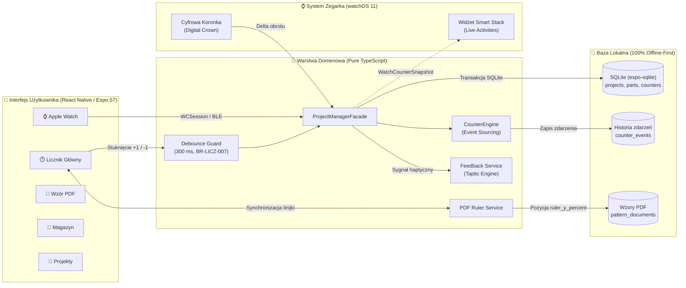

# Oczko (Purlo) 🧶⏱️

[](https://www.apple.com/ios/)
[](https://www.apple.com/watchos/)
[](https://expo.dev/)
[](https://reactnative.dev/)
[](https://www.typescriptlang.org/)
[](https://sqlite.org/)
[](docs/decyzje_biezace.md)
[](docs/decyzje_biezace.md)
[](https://github.com/lkarwowski494/Oczko/actions)

> **„Precyzyjny, wolny od rozpraszaczy licznik rzędów i asystent dziewiarski stworzony dla dziewiarek i dziewiarzy — zawsze z Tobą, na iPhone i Apple Watch.”**

Aplikacja mobilna na systemy **iOS 18+** oraz **watchOS 11+** dedykowana pasjonatom dziewiarstwa i szydełkowania, stworzona w architekturze **100% Offline-First** na bazie silnika SQLite. Integruje precyzyjny, odporny na przypadkowe dotknięcia licznik rzędów z obsługą warkoczy i ażurów, wbudowany czytnik wzorów PDF ze zsynchronizowaną pływającą linijką postępu, interaktywnego asystenta Apple Watch z obsługą fizycznej Cyfrowej Koronki (*Digital Crown*), magazyn włóczek z kontrolą partii farbowania (*Dye Lot*), trenażer ściegów oraz kalkulatory próbki i zużycia włóczki.

---

## 🌟 Główne Zasady Produktowe

- **100% Offline-First (Lokalne SQLite & Event-Sourcing):** Wszystkie widoki aplikacji czytają i zapisują dane wyłącznie do lokalnej bazy danych SQLite (`expo-sqlite`, `src/core/database.ts`). Każde naliczenie rzędu (`+1`, `-1`) rejestrowane jest jako niezmienne zdarzenie czasowe w tabeli `counter_events`. Stan robótki odtwarzany jest deterministycznie z historii zdarzeń. Zero opóźnień sieciowych, zerowy czas reakcji interfejsu.
- **Niezależny Companion Apple Watch & Smart Stack (DEC-03, BR-ZEG-003, BR-ZEG-009):** Pełna integracja z zegarkami Apple Watch. Umożliwia zliczanie rzędów za pomocą wielkiego, dotykowego przycisku `+1 Rząd` (idealnego do stuknięcia bez odkładania drutów), fizycznej Cyfrowej Koronki (*Digital Crown*) oraz wibracji haptycznych Taptic Engine. Widżety Smart Stack i Live Activities na bieżąco prezentują aktualny rząd i postęp części robótki.
- **Ochrona przed Przypadkowym Liczeniem (Debounce BR-LICZ-007):** Deterministyczny bufor czasowy (domyślnie $300\,\text{ms}$) ignorujący przypadkowe, podwójne stuknięcia ekranu lub drgania dłoni podczas intensywnego dziergania, co gwarantuje bezwzględną nienaruszalność licznika rzędów.
- **Wzory PDF z Pływającą Linijką Postępu (DEC-09, BR-WZOR-001, NFR-DOST-009):** Czytnik dokumentów PDF ze zsynchronizowaną, pływającą linijką (`ruler_y_percent`), która automatycznie przesuwa się w dół wraz z każdym kolejnym rzędem i automatycznie przełącza strony po osiągnięciu dolnego marginesu. Spełnia wyśrubowane normy dostępności cyfrowej dla osób słabowidzących.
- **Standaryzacja Craft Yarn Council (CYC) & Słownik Wielojęzyczny:** Matematyka dziewiarska, grubości włóczek (CYC 0–6: Lace, Fingering, Sport, DK, Worsted, Aran, Bulky, Super Bulky) oraz symbole diagramów oparte są o międzynarodowe normy branżowe. Słownik terminologii oferuje natychmiastowe tłumaczenia skrótów dziewiarskich (PL, EN-US, EN-UK, DE, FR).
- **Magazyn Włóczek & Narzędzi ze Śledzeniem Partii Farbowania (Dye Lot, BR-MAG-001 - 005):** Ewidencja zasobów dziewiarki z rozbiciem na składy surowcowe (Merino, Alpaka, Bawełna, Jedwab, Mohair), gramaturę, metraż oraz kluczowy dla odcieni dzianiny numer partii farbowania (*Dye Lot*).
- **Pojedyncze Źródło Prawdy & Czysta Architektura Domenowa:** Cała logika obliczeniowa i biznesowa (`src/core/`) jest całkowicie odizolowana od komponentów React Native i bibliotek widokowych. Umożliwia to wykonywanie pełnych testów jednostkowych i integracyjnych bez potrzeby uruchamiania emulatora.

---

## 📱 Moduły i Ekrany

1. **⏱️ Główny Licznik Rzędów & Tryby Pracy (`MainCounterScreen` / `app/(tabs)/index.tsx`):**
   - Wielka, wolna od zbędnych rozpraszaczy karta dotykowa `+1 Rząd` z czytelnym podglądem numeru rzędu.
   - Przycisk natychmiastowego wycofania błędnego kliknięcia `Cofnij (Undo)` z dedykowaną haptyką powrotną.
   - Płynny przełącznik trzech widoków roboczych: `Licznik`, `📜 Schemat & Linijka`, `📑 Wzór PDF`.
   - Pasek wyboru części robótki (np. Korpus, Rękaw lewy, Rękaw prawy) z celami rzędów (`targetRows`).
   - Szybkie przypomnienia cykliczne (co 4, 6, 8, 10, 12 rzędów lub wartość własna) z wibracją i etykietą zadania (np. „Dodaj oczko na brzegu”, „Zmiana splotu”).
2. **🪢 Liczniki Powiązane (Linked Counters — Warkocze & Ażury):**
   - Równoległe, automatyczne zliczanie rzędów powtórzeń motywów (np. warkocz C6F o cyklu 6 rzędów).
   - Osobne modulo-cykle i alerty operacji w wyznaczonym rzędzie cyklu powtórzenia.
3. **⌚ Apple Watch Companion & Live Activities (`DEC-03`, `DEC-08`, `BR-SYS-003`):**
   - Zoptymalizowany ekran zegarka (OLED 45 mm) z natychmiastowym feedbackiem haptycznym.
   - Obsługa fizycznego obrotu cyfrowej koronki (`Digital Crown`) z progiem czułości i buforem obrotu.
   - Kursorowe zrzuty stanu (`WatchCounterSnapshot`) dla widżetów Smart Stack i Live Activities na ekranie blokady iOS 18.
   - Kolejka offline buforująca stuknięcia na zegarku przy chwilowym braku łączności Bluetooth z telefonem.
4. **📑 Wzór PDF z Ruchomą Linijką Postępu (`DEC-09`, `BR-WZOR-001`, `NFR-DOST-009`):**
   - Import plików PDF oraz schematów graficznych za pośrednictwem natywnego selektora plików.
   - Pływająca linijka optyczna z regulacją wysokości i trybem wysokiego kontrastu dla czytelności drobnego druku.
   - Funkcja `Auto-krok` automatycznie przesuwająca linię czytania o zadany skok wraz z każdym krokiem licznika.
5. **📜 Schematy & Diagramy Splotów (`PatternGuideViewer`):**
   - Interaktywny diagram splotu (np. warkocz C6F) z dynamicznym podświetlaniem aktywnego rzędu robótki.
   - Zintegrowana linijka śledząca oraz kompletna legenda symboli dziewiarskich Craft Yarn Council (CYC).
6. **📁 Zarządzanie Projektami (`app/(tabs)/projects.tsx`):**
   - Podział na robótki aktywne (WIP — *Work in Progress*) oraz ukończone (FO — *Finished Objects*).
   - Dynamiczny pasek postępu procentowego bazujący na zdefiniowanych częściach i liczbie rzędów docelowych.
   - Generator estetycznych wizytówek projektu (`ProjectShareCardModal`) do udostępniania w mediach społecznościowych.
   - Wbudowany kalkulator próbki ściegu (`GaugeCalculatorModal`) oraz estymator zużycia włóczki (`YarnUsageEstimatorModal`).
7. **🧶 Magazyn Włóczek & Narzędzi (`app/(tabs)/stash.tsx`):**
   - Ewidencja włóczek: producent, nazwa, odcień, numer partii farbowania (`Dye Lot`), waga motka i metraż.
   - Ewidencja drutów i szydełek: rozmiar metryczny (mm) i US, długość żyłki, typ (proste, z żyłką, pończosznicze).
   - Inteligentny panel filtrów grubości CYC (0–6), tagi surowcowe (Merino, Alpaka, Bawełna, Jedwab, Syntetyki) oraz natychmiastowy agregator statystyk zasobów.
8. **🎓 Moduł Nauki & Trenażer Wzorów (`app/(tabs)/learn.tsx`):**
   - Wielojęzyczny słownik terminologii dziewiarskiej (PL, EN-US, EN-UK, DE, FR) z natychmiastową wyszukiwarką.
   - Interaktywny trenażer powtórzeń wzorów krok po kroku z instrukcjami dla strony prawej (RS) i lewej (WS).
   - Baza wiedzy i poradniki techniczne: dobór drutów do włóczki, pielęgnacja i blokowanie dzianin, anatomia oczek.
9. **⚙️ Ustawienia, Haptyka, Kopia i Bezpieczeństwo (`app/(tabs)/settings.tsx`):**
   - Panel konfiguracji haptyki Taptic Engine z możliwością odsłuchania na żywo każdego impulsu (`step`, `undo`, `cycle`, `goal`, `reminder`).
   - Pełna kopia zapasowa danych do pliku JSON z weryfikacją spójności schematu i bezpiecznym przywracaniem.
   - Diagnostyka bazy danych SQLite i monitorowanie stanu połączenia ze smartwatchem.

---

## 🔄 Architektura Przepływu Danych & Zdarzeń



| Mechanizm | Implementacja w kodzie | Gwarancja biznesowa |
|---|---|---|
| **Zapis i odczyt stanu** | `expo-sqlite`, `src/core/database.ts` | Czas odpowiedzi interfejsu $< 16\,\text{ms}$, brak blokad sieciowych |
| **Ochrona liczenia (Debounce)** | `src/core/counter-engine.ts`, `BR-LICZ-007` | Ignorowanie drgań i podwójnych kliknięć $< 300\,\text{ms}$ |
| **Historia i cofanie (Undo)** | Tabela `counter_events`, Event Sourcing | Precyzyjne cofanie kroków bez utraty spójności danych robótki |
| **Linijka postępu PDF** | `src/core/pattern-document-service.ts` | Automatyczne śledzenie wiersza wzoru bez ręcznego zaznaczania |
| **Apple Watch Companion** | `src/core/apple-watch-service.ts` | Niezależne liczenie na nadgarstku bez odkładania drutów |
| **Powiadomienia cykliczne** | `src/core/feedback-service.ts`, `BR-SYS-011` | Wibracja i komunikat o operacji co wybraną liczbę rzędów |

---

## 🧪 Wieloperspektywiczna Matryca Testów (Testing Rigor & DoD)

Projekt realizowany jest zgodnie ze ścisłą definicją ukończenia (DoD) wzorowaną na standardzie repozytorium [organizer](https://github.com/lkarwowski494/organizer):

1. **100% Pokrycia Linii Kodu (100% Lines Coverage):** Bezwzględny wymóg pełnego pokrycia testami dla wszystkich plików w projekcie (`app/(tabs)/`, `src/components/`, `src/screens/`, `src/core/`).
2. **Zero Regresji i 100% Testów Zielonych:** Wszystkie **41 pakietów testowych** i **268 testów** kończą się statusem PASS.
3. **Property-Based Testing (PBT / `fast-check`):** Testowanie niezmienników matematycznych (odwracalność zdarzeń $V + \Delta - \Delta = V$, monotoniczność debouncera, symetria konwersji jednostek $cm \leftrightarrow inch$, liniowe skalowanie metrażu) na tysiącach losowych danych wejściowych.
4. **Differential Testing / Niezależny Korpus Matematyczny:** Równoległa walidacja krzyżowa algorytmów dziewiarskich z niezależną referencyjną implementacją w Pythonie 3.14 (`scripts/gen-gauge-corpus.py` ↔ `gauge-corpus.test.ts`).
5. **Dostępność Cyfrowa i Kontrakty Apple HIG:** Minimalna powierzchnia dotyku $\ge 44 \times 44\,\text{pt}$, wysoki kontrast kolorów (WCAG AAA $\ge 7.0:1$), czytnik PDF w trybie wysokiego kontrastu oraz etykiety semantyczne VoiceOver.
6. **Strażnicy Architektury i Bezpieczeństwa:** Automatyczna weryfikacja statyczna ochrony przed SQL Injection (100% sparametryzowanych zapytań `?`), czystości architektury domenowej (`src/core/` wolne od importów `react-native`) i odporności modali.
7. **Budżety Wydajnościowe CPU (Performance Budget):** Gwarancja złożoności obliczeniowej $O(N)$ i brak wąskich gardeł (replay 5 000 zdarzeń $< 60\,\text{ms}$, filtrowanie 2 500 włóczek $< 40\,\text{ms}$, 10 000 kalkulacji próbki $< 50\,\text{ms}$).
8. **Odporność i Wstrzykiwanie Błędów (Resilience & Fault Injection):** Testowanie transakcyjnego wycofywania błędów w SQLite (Zero Partial Writes), odrzucania uszkodzonych i sfałszowanych kopii zapasowych JSON oraz odporności na anomalie zegara systemowego (Clock Skew).
9. **Współbieżność i Wyścigi (Concurrency & Race Conditions):** Rozstrzyganie remisów submilisekundowych, buforowanie i uzgadnianie kolejki zdarzeń offline zegarka (`WatchOfflineQueue`) oraz odporność na 25 równoległych asynchronicznych zapisów do SQLite.
10. **Statyczna Kontrola Typów TypeScript:** Weryfikacja całego projektu poleceniem `npx tsc --noEmit` kończąca się bez jakichkolwiek błędów czy ostrzeżeń typowania.
11. **Ciągła Integracja GitHub Actions (CI):** Automatyczna walidacja każdego commita i pull requesta na branchu `main` w środowisku CI.

---

## 🛠️ Uruchomienie i Weryfikacja

Wymagane środowisko: Node.js 20+ oraz npm.

```bash
# Instalacja zależności
npm install

# Pełna weryfikacja projektu (kontrola typów TypeScript + 100% testy z raportem pokrycia)
npm run verify

# Uruchomienie wszystkich 41 pakietów testowych Jest
npm test

# Uruchomienie testów z pełnym raportem pokrycia kodu (Coverage)
npm run test:coverage

# Dedykowane testy wieloperspektywiczne:
npm run test:pbt           # Property-Based Testing (fast-check)
npm run test:perf          # Budżety wydajnościowe CPU
npm run test:a11y          # Kontrakty dostępności Apple HIG (>= 44x44 pt)
npm run test:resilience    # Odporność, rollback transakcji i fault injection
npm run test:concurrency   # Współbieżność, Apple Watch offline queue i wyścigi
npm run test:corpus        # Testy różnicowe z korpusem referencyjnym
npm run check:corpus       # Regeneracja korpusu w Pythonie 3.14

# Statyczna kontrola typów TypeScript
npm run typecheck

# Uruchomienie aplikacji w środowisku deweloperskim Expo
npm start

# Uruchomienie aplikacji na symulatorze iOS
npx expo run:ios
```

---

## 📂 Architektura Kodu

```text
oczko/
├── app/                        # Expo Router — deklaratywne trasy i nawigacja
│   ├── _layout.tsx             # Root layout: SafeAreaProvider, ProjectProvider, Stack
│   └── (tabs)/                 # 5 głównych zakładek aplikacji
│       ├── _layout.tsx         # Konfiguracja paska zakładek (ikony, kolory, etykiety)
│       ├── index.tsx           # Zakładka 1: Licznik (re-export MainCounterScreen)
│       ├── projects.tsx        # Zakładka 2: Projekty (WIP, FO, kalkulatory, udostępnianie)
│       ├── stash.tsx           # Zakładka 3: Magazyn włóczek i narzędzi (filtry CYC, Dye Lot)
│       ├── learn.tsx           # Zakładka 4: Nauka (słownik wielojęzyczny, trenażer wzorów)
│       └── settings.tsx        # Zakładka 5: Ustawienia (haptyka, backup JSON, diagnostyka)
├── src/
│   ├── components/             # Reużywalne komponenty i modale UI
│   │   ├── AppleWatchCompanionModal.tsx   # Symulator Apple Watch z cyfrową koronką
│   │   ├── GaugeCalculatorModal.tsx       # Kalkulator próbki ściegu (mm, rzędy, oczka)
│   │   ├── PatternGuideViewer.tsx         # Przeglądarka diagramów ze standardem CYC
│   │   ├── PatternPdfViewer.tsx           # Czytnik wzorów PDF ze zsynchronizowaną linijką
│   │   ├── ProjectShareCardModal.tsx      # Generator kart podsumowania robótki (FO)
│   │   └── YarnUsageEstimatorModal.tsx    # Kalkulator szacowania zużycia włóczki
│   ├── core/                   # Czysta logika biznesowa i persistence (100% testów)
│   │   ├── apple-watch-service.ts         # Integracja watchOS, WCSession, cyfrowa koronka
│   │   ├── backup-service.ts              # Eksport i import kopii zapasowej JSON
│   │   ├── counter-engine.ts              # Silnik licznika, debounce 300 ms, event sourcing
│   │   ├── database-schema.ts             # Schemat DDL SQLite i indeksy relacyjne
│   │   ├── database.ts                    # Klient bazy SQLite (natywny + in-memory)
│   │   ├── device-sync.ts                 # Model synchronizacji wielu urządzeń
│   │   ├── domain-rules.ts                # Reguły biznesowe BR-LICZ, BR-PROJ, BR-MAG
│   │   ├── feedback-service.ts            # Obsługa Taptic Engine i powiadomień interwałowych
│   │   ├── gauge-calculator.ts            # Matematyka przeliczania próbek dziewiarskich
│   │   ├── glossary-data.ts               # Baza skrótów i terminów (PL, EN, DE, FR)
│   │   ├── pattern-document-service.ts    # Obsługa plików PDF i obliczanie linijki postępu
│   │   ├── pattern-guide-data.ts          # Dane wzorców dziewiarskich i symbole CYC
│   │   ├── pattern-parser.ts              # Parser instrukcji dziewiarskich
│   │   ├── pattern-trainer.ts             # Silnik trenażera powtórzeń krok po kroku
│   │   ├── project-context.tsx            # Globalny stan robótki React Context
│   │   ├── project-facade.ts              # Fasada orkiestrująca projekty i liczniki
│   │   ├── project-repository.ts          # Repozytorium SQLite dla projektów i zdarzeń
│   │   ├── project-service.ts             # Serwis cyklu życia robótki i liczników powiązanych
│   │   ├── project-summary.ts             # Agregator statystyk i formatowanie udostępniania
│   │   ├── stash-filter-service.ts        # Filtrowanie włóczek, tagi surowcowe, standardy CYC
│   │   ├── stash-repository.ts            # Repozytorium SQLite magazynu włóczek i drutów
│   │   └── yarn-usage-estimator.ts        # Szacowanie metrażu i wagi dla typów dzianin
│   └── screens/                # Ekrany aplikacji
│       └── MainCounterScreen.tsx          # Główny ekran licznika z 3 trybami widoku
├── docs/                       # Dokumentacja projektowa i decyzje architektoniczne
│   └── decyzje_biezace.md      # Rejestr decyzji (DEC-01 do DEC-25) i kamieni milowych
├── .github/                    # Konfiguracja CI/CD
│   └── workflows/ci.yml        # Pipeline GitHub Actions (typecheck + testy)
├── babel.config.js             # Konfiguracja Babel dla Expo
├── jest.config.js              # Konfiguracja środowiska testowego Jest dla Expo/iOS
├── package.json                # Zależności i skrypty weryfikacji
└── tsconfig.json               # Konfiguracja kompilatora TypeScript (Strict Mode)
```

---

## 📖 Dokumentacja i Rejestr Decyzji

- **Rejestr decyzji i kamieni milowych:** [`docs/decyzje_biezace.md`](docs/decyzje_biezace.md)
- **Standardy grubości włóczek i symboli:** [Craft Yarn Council Standards](https://www.craftyarncouncil.com/standards)
- **Wytyczne interfejsu:** [Apple Human Interface Guidelines (iOS & watchOS)](https://developer.apple.com/design/human-interface-guidelines/)

---

## 📄 Status & Dystrybucja

- **Dystrybucja:** Wersja deweloperska i testowa w ekosystemie Expo / iOS 18+.
- **Zasady interakcji:** Pełna zgodność z iOS Human Interface Guidelines, wsparcie VoiceOver, Dynamic Type i wysoki kontrast WCAG AAA.
- **Prywatność i bezpieczeństwo:** Architektura 100% Offline-First — wszystkie dane projektów, zdjęcia wzorów i stan magazynu przechowywane są wyłącznie lokalnie na urządzeniu użytkownika w bazie SQLite.
