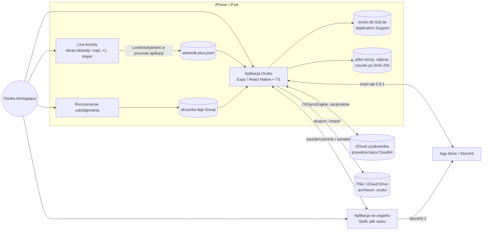

# Architektura Oczka (rola 05, build, 2026-10-22)
Stan: E0–E3 przyjęte (P-070–P-073), E4 przekazanie. Krótko, z odnośnikami; szczegóły w plikach obok.

## 1. Cel i zakres
- Obsługuje przepływy z [`docs/scope-contract.md`](../scope-contract.md) (PR-01–PR-11, PR-13 tylko wpisanie wartości, PR-14–PR-16 bez BR-DNI-007; 49 funkcji MVP) w modelu V4 (P-057) na iOS 18 / iPadOS 18 / watchOS 11 (P-070).
- Wszystko działa bez sieci (NFR-OFF-001); baza na urządzeniu jest źródłem prawdy; koszt stały 0 zł (NFR-KOS-001); brak serwera, konta, analityki i reklam.
- **Świadomie poza zakresem:** funkcje PÓŹNIEJ (F-13 Siri, F-22, F-29, F-39, F-40, F-42, F-44 słownik, F-62) — bez tabel i zależności; Android (P-011); AI (ZAL-024); widżet ekranu głównego; migracja danych 0.1.0 (P-070 (2c), ADR-0015); raportowanie awarii (rola 12); manifest i formularz App Privacy (rola 10); wygląd i teksty (rola 04).

## 2. Rejestr ograniczeń platformy
Pełne tabele (wartość, adres, cytat, data odczytu 2026-10-22): [`rejestr/apple.md`](rejestr/apple.md), [`rejestr/expo.md`](rejestr/expo.md), [`rejestr/sqlite.md`](rejestr/sqlite.md) + eksperymenty [`eksperymenty/`](eksperymenty/). Ograniczenia, które zmieniły decyzje (G-01–G-18, wpływ na ADR): [`e0-rozpoznanie.md` §4](e0-rozpoznanie.md). Najważniejsze:
| Ograniczenie | Wpływ |
|---|---|
| `LiveActivityIntent` (iOS 17+) działa w procesie aplikacji, uruchamianej bez interfejsu; przy zablokowanym telefonie dokumentacja sprzeczna (apple 1e–1g) | ADR-0008: dziennik +1 bez SQLite; ZAL-030 ryzyko szczątkowe (P-070 (3a)) |
| `expo-sqlite` ma własną kopię SQLite; dwie kopie w procesie mogą uszkodzić bazę (expo 13, sqlite 9c) | brak `SQLite3` w Swift |
| `withExclusiveTransactionAsync` = nowe połączenie bez kluczy obcych (`expo-sqlite@57.0.4` `:789`) | ADR-0002: jedna kolejka |
| `0xdead10cc`: blokada pliku w czasie zawieszenia (apple 2b) | krótkie transakcje, `beginBackgroundTask` dla eksportu |
| Kopia samego `.db` w WAL gubi zapisy przy `integrity_check = ok` (eksperyment D) | ADR-0004: `VACUUM INTO` |
| `CKSyncEngine`: iOS 17 / watchOS 10, uprawnienia CloudKit i Remote notifications (apple 8c, 19a) | ADR-0005; jedyny tryb tła `remote-notification` |
| `expo-iap` bez watchOS (expo 5b); `transferUserInfo` kolejkuje, brak w symulatorze (apple 4a) | ADR-0009 |
| Runnery macOS GitHub darmowe w repo publicznym; sekrety niedostępne z forków (apple 12, 18a, 18b) | ADR-0014 |

## 3. Kontekst (C4 poziom 1–2)

## 4. Moduły, zależności, porty
[`moduly.md`](moduly.md): drzewo `src/` (`domena` → czysty TS; `dane`, `platforma` → adaptery; `przypadki-uzycia`; `konfiguracja.ts`), porty (`PortBazy`, `Zegar`, `MagazynPlikow`, `DziennikPlus`, `LiveActivity`, `Zegarek`, `Synchronizacja`, `Sklep`, …), ścieżka zapisu +1, maszyny stanów. Kontrola granic: [`narzedzia/granice.mjs`](narzedzia/granice.mjs). Zależności: [ADR-0016](../adr/0016-zaleznosci-wersji-1.md).

## 5. Dane, tło, konfiguracja, błędy, prywatność, wydajność
- Dane: [`dane.md`](dane.md) (ERD, cykl życia, migracje 12 kroków, kopie i archiwum, 22 ścieżki utraty danych), [`schemat.sql`](schemat.sql) v1, [`stany.json`](stany.json), dowód: [`narzedzia/sprawdz-schemat.mjs`](narzedzia/sprawdz-schemat.mjs) 32/32.
- Praca w tle, polityka błędów, budżety wydajności, lista kontroli dla 07: [`e3-tlo-bledy-prywatnosc-wydajnosc.md`](e3-tlo-bledy-prywatnosc-wydajnosc.md).
- Konfiguracja: [`moduly.md` „Konfiguracja”](moduly.md) (17 parametrów).
- Prywatność: [`prywatnosc.md`](prywatnosc.md) (inwentarz, uprawnienia, required reason API zależności i aplikacji).

## 6. Ryzyka, otwarte pytania, indeks ADR
**Ryzyka szczątkowe (P-041: bez testów ręcznych):** +1 z ekranu blokady przy zablokowanym telefonie (ZAL-030); zegarek poza zasięgiem i iCloud między prawdziwymi urządzeniami (NFR-ZEG-001, NFR-DAN-003); bateria; paczka społeczności `@bacons/apple-targets` w ścieżce buildu (ADR-0007); `expo-iap` 5.x obok głównej linii 6.x (ADR-0010); klucz App Store Connect w sekretach publicznego repo (P-071 (6b), ADR-0014).

**Otwarte [DO USTALENIA]** (każde ma właściciela i sposób sprawdzenia):
| Pytanie | Kto | Jak |
|---|---|---|
| Wersja SQLite w `expo-sqlite@57.0.4` na urządzeniu | 07 | `SELECT sqlite_version()` na symulatorze |
| Checkpoint WAL przed kopią urządzenia | — | zabezpieczenie bez zależności od odpowiedzi: checkpoint przy przejściu w tło |
| `WKWebView` renderuje `.docx` wiernie? | 08 + 07 | test na symulatorze z korpusem; wariant QuickLook (P-071 (5a)) |
| `expo-image-picker` usuwa EXIF przy `exif: false`? | 07 | test pliku; zabezpieczenie: karta renderowana od nowa (P-073) |
| „Collected” dla CloudKit i archiwum; OP-25 („Zgłoś problem”) | 10 | App Privacy u źródła Apple |
| Rola klucza ASC API, wariant podpisu w CI | 10 | dokumentacja Apple, próba w CI |
| Biblioteka ZIP (strumieniowo, 400 MB) | 08 z 05 | próba na symulatorze (ADR-0016) |
| Para watchOS 11 ↔ iOS 18 | 08 | dokumentacja watchOS przy celu zegarka (niekrytyczne, ADR-0006) |
| Manifesty prywatności celów Swift | 08 / 10 | przy kodzie celów |
| `PRODUKTY_PRO` (ID), Family Sharing | właściciel | P-038, konfiguracja App Store Connect |
| Liczby obliczeń F-38, tabela drutów RD-11 | 06 | rejestr merytoryczny |

**Indeks ADR** (wszystkie przyjęte):
| ADR | Decyzja | Decyzja właściciela |
|---|---|---|
| [0001](../adr/0001-przechowywanie-sqlite-pliki-poza-baza.md) | SQLite w `Application Support`, pliki poza bazą | P-071 |
| [0002](../adr/0002-sciezka-zapisu-jedna-kolejka.md) | jedna kolejka zapisów, `foreign_keys = ON` | P-071 |
| [0003](../adr/0003-granice-modulow-i-stan-interfejsu.md) | domena w czystym TS, baza jedynym źródłem prawdy | P-071 |
| [0004](../adr/0004-kopia-eksport-import.md) | archiwum `.oczko` z plikami, scal / zastąp | P-071 (4a) |
| [0005](../adr/0005-synchronizacja-icloud-cloudkit-dziennik.md) | CloudKit `CKSyncEngine`, konflikt pokazany | P-071 |
| [0006](../adr/0006-minimalne-wersje-ios-18-watchos-11.md) | iOS 18 / watchOS 11 | P-070 (1a) |
| [0007](../adr/0007-cele-natywne-apple-targets-i-moduly-expo.md) | cele Swift przez `@bacons/apple-targets` | P-071 |
| [0008](../adr/0008-plus-jeden-z-ekranu-blokady-dziennik.md) | +1 z ekranu blokady przez dziennik | P-070 (3a), P-071 |
| [0009](../adr/0009-zegarek-transport-limit-pro.md) | zegarek: kolejka + kontekst, Pro bez telefonu | P-071 |
| [0010](../adr/0010-zakupy-expo-iap-5-8-1.md) | `expo-iap` 5.8.1 | P-071 |
| [0011](../adr/0011-import-wzorow-rozszerzenie-pdf.md) | rozszerzenie → PDF na urządzeniu | P-071 (5a) |
| [0012](../adr/0012-rysik-i-zakreslacz-pencilkit.md) | PencilKit nad PDFKit | P-071 |
| [0013](../adr/0013-maszyny-stanow-w-domenie.md) | maszyny stanów w domenie, CHECK z `stany.json` | P-071 |
| [0014](../adr/0014-build-i-ci.md) | GitHub Actions macOS, sekrety w środowisku `testflight` | P-071 (6b) |
| [0015](../adr/0015-dane-wersji-0-1-0-czysty-start.md) | czysty start, stary plik nietknięty | P-070 (2c) |
| [0016](../adr/0016-zaleznosci-wersji-1.md) | 14 pakietów + moduły Swift | P-073 |
