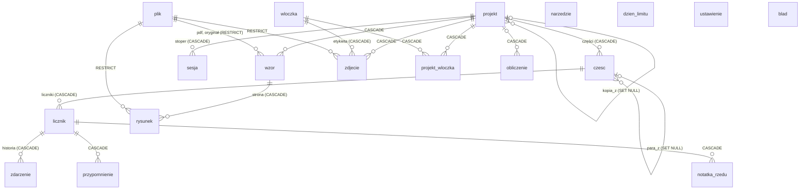

# Model danych, migracje, kopie i eksport (rola 05, E2, 2026-10-22)
Schemat: [`schemat.sql`](schemat.sql) (wersja 1), listy stanów: [`stany.json`](stany.json). Dowód uruchomienia: `node --no-warnings docs/architektura/narzedzia/sprawdz-schemat.mjs` → 32/32 OK, kod wyjścia 0 (`narzedzia/sprawdz-schemat.out`; SQLite 3.50.4, Node v22.22.0). Kontrola negatywna (stan spoza CHECK, brak kaskady zdarzeń) → 3 błędy, kod wyjścia 1 (`narzedzia/kontrola-negatywna/`). Wersja SQLite na urządzeniu: ta, którą kompiluje `expo-sqlite@57.0.4` (`sqlite3.c` w paczce, rejestr Expo 13) [DO USTALENIA: `SELECT sqlite_version()` w teście na symulatorze, rola 07]; STRICT wymaga ≥ 3.37, UPSERT ≥ 3.24.

## ERD

Każda funkcja zapisująca z kontraktu (05: F-01, F-02, F-04–F-06, F-08, F-14–F-21, F-24–F-28, F-31–F-38, F-45–F-61) ma tabelę w komentarzu `schemat.sql`. Funkcje PÓŹNIEJ (F-13, F-22, F-29, F-39, F-40, F-42, F-44, F-62) nie mają tabel. Licznik całości (F-46) i procent (F-60) są liczone, nie zapisywane. Karta ukończenia (F-53) jest generowana przy udostępnieniu, nie przechowywana.

## Krytyczność i cykl życia
| Dane | Kto tworzy | Da się odtworzyć? | Od zapisu do usunięcia |
|---|---|---|---|
| zdarzenia licznika, wartość, notatki, części, projekty | użytkownik | **nie** | zapis w kolejce → kopia urządzenia / iCloud / archiwum → „Ostatnio usunięte” 30 dni → kaskada |
| wzory (PDF, oryginał), rysunki, zdjęcia | użytkownik | **nie** (oryginał może mieć użytkownik gdzie indziej) | plik + odwołanie → sprzątanie pliku bez odwołań po COMMIT usunięcia |
| zapas, narzędzia, obliczenia | użytkownik | nie | jak wyżej (zapas: `usunieto_ms`, 30 dni) |
| dni limitu | aplikacja | nie (dane użytkownika synchronizowane iCloud, KP-15) | dopisywane; scalenie z innym urządzeniem = suma po dacie, `pro` = OR (`scalDni`, L-20, P-109; zapis niżej), nigdy nie odbiera rozpoczętego dnia (L-16); zostają po usunięciu licznika albo projektu (P-072 (8a): inaczej usunięcie licznika zwalniałoby dzień limitu); usuwane tylko przez „usuń wszystko” (F-34) |
| `licznik.wartosc`, `glowa`, `konflikt` | aplikacja | **tak** (`scal` nad zdarzeniami) | pamięć podręczna w tej samej transakcji co zdarzenie |
| `ustawienie`, `blad` | aplikacja | tak / nie potrzeba | `blad` przycinany do `BLEDY_MAKS_WIERSZY` |
| uprawnienie Pro | App Store | **tak** (StoreKit, ADR-0010) | nie przechowywane jako źródło prawdy; ostatni stan dla zegarka w `ustawienie` |

## Dni limitu: zapis i scalenie (fix 2026-10-25, P-109)
Jedna instrukcja dla trzech ścieżek: start dnia w `dodajRzad` (moduly.md, krok 3), scalenie dziennika +1 i zegarka (ADR-0008, ADR-0009) oraz synchronizacja iCloud i import „scal” (ADR-0005, ADR-0004). Wynik jest równy `scalDni()` z `docs/monetyzacja/limit.mjs` (L-20–L-20e, L-23): jedna data = jeden wiersz; dzień raz zaczęty z Pro zostaje dniem z Pro (`pro` = OR); zostaje najwcześniejszy start dnia i zdarzenie, które go zaczęło. Wiersza nigdy nie usuwa żadna z tych ścieżek (L-16). Kontrola: `sprawdz-schemat.mjs` wykonuje ten blok.
```sql
-- zapis-dnia-limitu.sql (parametry: dzien, pro, zaczeto_ms, zdarzenie_id)
INSERT INTO dzien_limitu (dzien, pro, zaczeto_ms, zdarzenie_id) VALUES (?, ?, ?, ?)
ON CONFLICT (dzien) DO UPDATE SET
  pro = max(pro, excluded.pro),
  zdarzenie_id = CASE WHEN excluded.zaczeto_ms < zaczeto_ms THEN excluded.zdarzenie_id ELSE zdarzenie_id END,
  zaczeto_ms = min(zaczeto_ms, excluded.zaczeto_ms);
```
SQLite liczy wszystkie wyrażenia `SET` na wartościach wiersza sprzed aktualizacji, więc kolejność `zdarzenie_id` i `zaczeto_ms` nie zmienia wyniku (sprawdzone w `sprawdz-schemat.mjs`: wcześniejszy start z drugiego urządzenia ustawia oba pola).

## Polityka migracji
- Wersja w `PRAGMA user_version`; migracje to dane w `src/dane/migracje/` (`0001.sql` = `schemat.sql` v1), uruchamiane przed pierwszym zapytaniem przez runner z modułu `dane-lokalne-sqlite` (wersja w `sprawdz-schemat.mjs` jest jego odpowiednikiem dla `node:sqlite`). **Wydanej migracji nie zmieniamy**; poprawka = nowa migracja.
- Dodanie kolumny, tabeli, indeksu: zwykła migracja w transakcji. Każda inna zmiana tabeli: 12 kroków sqlite.org (`PRAGMA foreign_keys=OFF` **przed** `BEGIN`, nowa tabela, kopia, `DROP`, `RENAME new_X`, odtworzenie indeksów, `foreign_key_check` pusty, `COMMIT`, `ON`); eksperyment B (E0) pokazał, że `OFF` w transakcji nic nie robi.
- Przed migracją z przebudową: `VACUUM INTO` do `Application Support/kopie/przed-migracja-<wersja>.db`, usuwana po udanym starcie.
- Baza nowsza niż aplikacja: odrzucona bez zmian (sprawdzone), komunikat „Zaktualizuj aplikację” (tekst: 04).
- **Test na kopii każdej wydanej wersji** (rola 07): wzorzec `tests/bazy/vN.db` tworzony przy wydaniu wersji schematu N (migracje 1..N + dane brzegowe: puste napisy, NULL, wiersze podrzędne, konflikt licznika, usunięte 29 i 31 dni temu); kopia → `migruj` → liczności każdej tabeli, `integrity_check = ok`, `foreign_key_check` pusty, `user_version`, drugie uruchomienie bez zmian; przypadek negatywny (dane łamiące nowe CHECK → wycofanie całości; sprawdzone w `sprawdz-schemat.mjs`). Wersja 0.1.0 poza testem (P-070, ADR-0015).

## Kopie i eksport
- **Kopia urządzenia (iCloud/komputer):** `Application Support/` (baza z `-wal`/`-shm` i pliki) jest w kopii (rejestr Apple 9a). Kopia systemowa robi migawkę plików, nie `VACUUM INTO` [DO USTALENIA: czy system wykonuje checkpoint przed kopią — brak w dokumentacji]; zabezpieczenie: WAL checkpoint (`PRAGMA wal_checkpoint(TRUNCATE)`) przy przejściu aplikacji w tło, krótki, w kolejce, przed zawieszeniem.
- **Archiwum `.oczko`** (ADR-0004, P-071 (4a)): ZIP z `manifest.json` (`format: "oczko"`, `wersja_formatu`, `wersja_schematu`, `aplikacja`, `utworzono`, liczności tabel, `pliki: [{sha256, bajty}]`), `oczko.db` z `VACUUM INTO` (przed nim scalenie dziennika +1, ADR-0008), katalog `pliki/`. SHA-256 liczone z bajtów plików w archiwum.
- **Import:** weryfikacja w katalogu tymczasowym (manifest, wersje, SHA-256, miejsce) → migracja kopii do bieżącego schematu tym samym runnerem → „scal” (po UUID; zdarzenia przez `scal`, encje według `zmieniono_ms`) albo „zastąp” (najpierw `VACUUM INTO` „kopii przed importem” na 30 dni). Nowsza wersja albo zły SHA-256 → odrzucenie bez zapisu.
- **Nigdy kopia samego pliku `.db`** (eksperyment D: 0 ze 100 wierszy przy `integrity_check = ok`).

## Ścieżki utraty danych
| Ścieżka | Zabezpieczenie | Test (rola 07, chyba że zaznaczono) |
|---|---|---|
| Zabicie procesu zaraz po +1 (NFR-DAN-002) | zapis w transakcji przed haptyką i odświeżeniem; WAL; `COMMIT` przed potwierdzeniem | test z zabiciem procesu po każdej zmianie (symulator): liczba zdarzeń = liczba potwierdzonych stuknięć |
| +1 z ekranu blokady, JS nie działa | dziennik `.jsonl` z `fsync` w intencji, scalanie przy starcie (ADR-0008) | XCTest 1000 równoległych dopisań; wektor M-02 (podwójne scalenie) |
| Przerwany zapis linii dziennika | uszkodzona ostatnia linia pomijana, poprzednie zachowane, wpis w `blad` | XCTest z uciętą linią |
| Aktualizacja aplikacji ze zmianą schematu (NFR-DAN-001) | runner, 12 kroków, `VACUUM INTO` przed przebudową | test na kopii każdej wydanej wersji (liczności) |
| Migracja łamiąca CHECK | jedna transakcja, ROLLBACK całości | `sprawdz-schemat.mjs` (OK) + test runnera w aplikacji |
| Kaskada po `INSERT OR REPLACE` | tylko UPSERT; grep `OR REPLACE` w CI | `sprawdz-schemat.mjs` (kontrola: REPLACE kasuje 2 → 0) |
| Zapis na połączeniu bez kluczy obcych | jedna kolejka, zakaz `withExclusiveTransactionAsync` (ADR-0002) | `PRAGMA foreign_keys` w transakcji przez port = 1 |
| Zawieszenie z blokadą pliku (`0xdead10cc`) | krótkie transakcje, brak `await` poza bazą w transakcji, eksport/import pod `CzasWTle.chron` | test: transakcja z `await` na timer odrzucona przez port (wykrycie w trybie deweloperskim); scenariusz urządzenia (P-041: ryzyko szczątkowe) |
| Kopia samego `.db` przy WAL | eksport tylko `VACUUM INTO` | grep kopiowania ścieżki bazy w CI; test eksportu (liczności) |
| Import pliku nowszej wersji | odrzucenie przed zapisem | test: `wersja_schematu + 1` → baza bez zmian |
| Import „zastąp” niechciany | kopia przed importem 30 dni | test: zastąp → przywróć kopię → liczności jak przed |
| Podwójny import / powtórzone dostarczenie (zegarek, iCloud) | idempotencja po UUID (`scal`) | wektor M-02, test archiwum dwa razy |
| Równoległa praca na dwóch urządzeniach (NFR-DAN-003, NFR-ZEG-001) | `konflikt` pokazany, rozstrzygnięcie użytkownika (M-04, M-05) | wektory M-04, M-05, mutant „suma” (6/7) |
| Usunięcie przez pomyłkę (F-33) | `usunieto_ms`, 30 dni, przywracanie | test maszyny projektu: usuń → przywróć; 29 dni zostaje, 31 dni sprzątnięte |
| Usunięcie pliku używanego przez wzór | `ON DELETE RESTRICT`, sprzątanie tylko plików bez odwołań | `sprawdz-schemat.mjs` (OK); test sprzątania |
| Plik w `Caches`, usunięty przez system | baza i pliki tylko w `Application Support` (ADR-0001) | test ścieżek po prebuild |
| Brak miejsca przy zapisie / eksporcie | sprawdzenie `wolneMiejsce` przed eksportem i importem; błąd zapisu nigdy cicho (polityka błędów E3) | atrapa magazynu z błędem `SQLITE_FULL` → komunikat, dane do ponowienia |
| Restart telefonu przed odblokowaniem, +1 z ekranu blokady | klasa ochrony domyślna; intencja zwraca błąd, komunikat „odblokuj” | ryzyko szczątkowe (P-041), XCTest z atrapą niedostępnego pliku |
| Stoper zapomniany / proces zabity w trakcie sesji | czas ze znaczników, `SESJA_MAKS_H` | wektory maszyny sesji |
| Zmiana strefy czasowej (RD-16) | `dzien` i `strefa` zapisane w zdarzeniu, nie przeliczane | wektory RD-16 |
| Dane 0.1.0 | stary plik nietknięty (P-070, ADR-0015) | test: stary plik ma ten sam SHA-256 po starcie |
| „Usuń wszystkie dane” (F-34) przez pomyłkę | potwierdzenie (04) i zdanie o zakupie (KP-05) | test UI; po usunięciu Pro wraca z App Store (W-*) |
