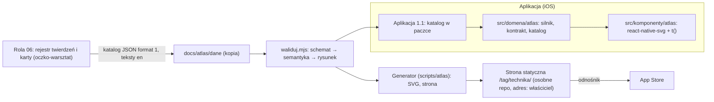

# Atlas technik (1.1) — architektura

Rola 05, build, 2026-10-26. Decyzje: P-093 (2), P-095, P-178, P-179, P-192, P-201, P-207, P-213. Etapy: [E0](e0-rozpoznanie.md) · [E1](e1-decyzje.md) · [E2](e2-moduly-dane.md) · [E3](e3-bledy-prywatnosc-wydajnosc.md). Stan roli 05: [stan-05.md](stan-05.md); stan treści roli 06: [stan.md](stan.md).

## 1. Cel i zakres

Atlas technik dziewiarskich w aplikacji (1.1–1.2) i na osobnej stronie statycznej, z jednego katalogu JSON z ID twierdzeń roli 06. Rysunki liczone w kodzie z danych (bez generatora obrazów, P-178), bez tekstu i liter, jeden plik na wszystkie języki (P-192); podpis, kroki i opis VoiceOver przez `t()`.

Świadomie poza zakresem: kod aplikacji 1.0 (`app/`, `src/` bez zmian); przepływy atlasu w kontrakcie zakresu (dopisze 03, Z-03-01); wygląd rysunków i strony (04, Z-04-01–03); rodziny `graf-szydelkowy` i `nabieranie`, fazy `narzut`/`przeciagniecie`/`zdjecie`, operacje inne niż `oczko` i `scal` 2 oczek (kontrakt je przyjmuje, silnik jeszcze nie rysuje); dane użytkownika (atlas nic nie zapisuje).

## 2. Rejestr ograniczeń platformy

[E0 §5](e0-rozpoznanie.md#5-rejestr-ograniczeń-platformy-odczyt-2026-10-26) — `react-native-svg` 15.15.4 dla SDK 57 (MIT, 2026-03-18), `expo-image` i dekoder SVG iOS (bez łuków `A`), hreflang (każda wersja wymienia siebie i pozostałe; x-default), hosting statyczny: jedna strona na repozytorium, 1 GB, 100 GB/mies., ≤ 10 min wdrożenia, przeznaczenie. Kopie: `oczko-warsztat/05-architekt/2026-10-26-atlas/zrodla/`.

## 3. Kontekst (C4, poziom 1–2)

## 4. Moduły i porty

[E2 §1](e2-moduly-dane.md#1-granice-modułów-stan-docelowy-11-dziś-kod-w-scriptsatlas-bo-10-jest-w-budowie): domena `geometria`, `typy`, `siatka-petli`, `kontrakt`, `katalog` (czysty TS); generator `svg`, `sprawdz`, `strona` + CLI `generuj.mjs`, `waliduj.mjs`, `strona.mjs`, `migruj-0-1.mjs`. Porty katalogu: `czytaj`, `sha256`, `dekoduj`. Kierunek: komponenty/dane/generator → domena; domena bez SVG (rysunek do walidatora wstrzykiwany). `granice.mjs` na symulacji układu: OK.

## 5. Dane, konfiguracja, błędy, prywatność, wydajność

- Kontrakt: [kontrakt-krokow.md](kontrakt-krokow.md) (wersja 1.1, `format: 1`), schemat [katalog.schema.json](katalog.schema.json); manifest `atlas.json` z SHA-256; bez bazy, bez migracji, bez zapisu ([E2 §2](e2-moduly-dane.md#2-dane-bez-bazy--moduł-pakiety-tresci-arch-22)).
- Założenia silnika A-1–A-3 (kierunek przeciągania, ujęcia, wymiary ilustracyjne): [E2 §3](e2-moduly-dane.md#3-założenia-silnika-nazwane-zasada-wspólna-7).
- Konfiguracja (jedna lista): [E2 §4](e2-moduly-dane.md#4-konfiguracja-jedna-lista) — `ATLAS_JEZYK_BEZ_ZRODLA` (domyślnie `angielski`, Q3 u właściciela), szydełko tylko w dokładnym wariancie (P-213), `ATLAS_ADRES` (Q2), `ATLAS_SKLEP` (10).
- Błędy: [E3 §2](e3-bledy-prywatnosc-wydajnosc.md#2-polityka-błędów-atlasu-na-bazie-wzorca-roli). Prywatność: brak danych, brak sieci ([E3 §3](e3-bledy-prywatnosc-wydajnosc.md#3-prywatność-docsarchitekturaprywatnoscmd--dopisek-dla-roli-10-w-przekazaniu-e4)). Budżety z metodą: [E3 §4](e3-bledy-prywatnosc-wydajnosc.md#4-budżety-wydajności-pomiar-bazowy-cel-ustala-właściciel-na-podstawie-pomiaru).

## 6. Ryzyka i otwarte pytania

| ID | Ryzyko / pytanie | Stan |
|---|---|---|
| R-A1 | Przeplot w 2D | rozwiązany łatkami (E2); ujęcia 3 oczek i lewe — ograniczenie geometrii, blokowane walidatorem (E3 §5) |
| R-A2 | Rozjazd pól z 06 | kontrakt 1.1 + walidator + narzędzie przejścia; 50 błędów do decyzji 06 |
| R-A3 | Kolizje numerów ADR | 0022–0025 zajęte; `kontrola-adr` 25/0 |
| R-A4 | Przeznaczenie hostingu | decyzja przy starcie strony (Q2) |
| R-A5 | Język bez źródła | `jezyki_gotowe`, P-213, testy |
| R-A6 | Czas i rozmiar na telefonie | `[DO ZMIERZENIA]` na urządzeniu (E3 §4) |
| Q2 | Hosting i domena | właściciel |
| Q3 | Atlas w języku bez źródła (`angielski` / `ukryj`) | właściciel |
| — | `drut.grot`, warianty M1 i 2/2 w jednej karcie | 06 (Z-06-02, Z-06-04) |

## 7. Indeks ADR

| ADR | Decyzja | Status |
|---|---|---|
| [0022](../adr/0022-atlas-silnik-rysunkow-ts-z-danych.md) | silnik TS z danych, przeplot z reguł (łatki), SVG bez tekstu | proponowana |
| [0023](../adr/0023-atlas-kontrakt-danych-katalogu-json-schema.md) | JSON + JSON Schema + własny walidator | proponowana |
| [0024](../adr/0024-atlas-rysunek-w-aplikacji-react-native-svg.md) | `react-native-svg` 15.15.4 w 1.1 | przyjęta (P-201) |
| [0025](../adr/0025-atlas-tresc-w-paczce-i-strona-statyczna.md) | katalog w paczce, strona z hreflang | proponowana, warunkowa (Q2, Q3) |
| [0016](../adr/0016-zaleznosci-wersji-1.md) | uzupełnienie: szkic wiersza `react-native-svg` | dla 08 przy instalacji |

## 8. Definicja ukończenia (build) — sprawdzenie punkt po punkcie

| Punkt | Dowód |
|---|---|
| Każdy moduł i zależność wynika z przepływu | przepływy A1–A3, S1–S3, G1 (E0 §3) → moduły E2 §1; jedyna zależność natywna `react-native-svg` (A2–A3); **wyjątek nazwany:** przepływy z decyzji P-093/P-179, nie z kontraktu zakresu (Z-03-01) |
| ADR: data, status, ≥ 2 opcje, konsekwencje, potwierdzenie; ADR o przechowywaniu z wariantem bez bazy | `kontrola-adr.mjs docs/adr --min 25` → 25 ADR, 0 błędów; ADR-0025 rozważa katalog bez bazy (pliki JSON) i pakiet pobierany |
| Rejestr ograniczeń: adres, cytat, data | E0 §5 (7 pozycji, odczyt 2026-10-26, kopie w `oczko-warsztat`) |
| SQLite: schemat, integrity, kaskada, UPSERT | nie dotyczy (brak bazy; moduł `dane-lokalne-sqlite` nie stosowany, E0 §6) |
| Bez bazy: format z wersją, odrzucenie nowszej, zapis atomowy | E2 §2; testy manifestu; zapis atomowy nie dotyczy (brak zapisu), nazwane |
| Tabela ścieżek utraty danych | E2 §5 |
| Jedna lista parametrów konfiguracyjnych | E2 §4 |
| Budżety z urządzeniem, danymi, percentylem, metodą | E3 §4; liczby na telefonie `[DO ZMIERZENIA]` (krok właściciela), bez liczb bez pomiaru |
| Inwentarz prywatności dla 10 | E3 §3 (brak danych; manifest `react-native-svg` po instalacji) |
| Lista kontroli automatycznych dla 07 | E3 §6 (K-A1–K-A8) |
| Prototyp ryzyka (zlecenie) | 5 rysunków próbnych, testy geometrii i strażnik liter, PNG (`docs/atlas/prototyp/`); na danych 06: ściegi przechodzą, ograniczenia nazwane (E3 §5) |
| Testy | `npx jest scripts/atlas` 96/96; pełny `verify` w commicie E4 |

## 9. Przekazanie

- **06:** kontrakt 1.1 i walidator (`waliduj.mjs`), narzędzie przejścia `migruj-0-1.mjs` (wynik: 50 błędów do decyzji, lista w `kontrakt-krokow.md` „Rozbieżności” — `rozszerzenie_06`, `opis_alt` nabierania, `probka.rzedy` 1, M1 `skret`); Z-06-02 (`drut.grot`), Z-06-04 (jedna karta = jedna technika: M1R/M1L, 2/2 RC/LC); ID kart i twierdzeń w kartach próbnych zgodne z rejestrem 06.
- **07:** K-A1–K-A8 (E3 §6); K-A5 informacyjna do przejścia danych 06 na format 1; testy `scripts/atlas` już w `npm test`.
- **08 (start 1.1):** kolejność: domena (`scripts/atlas/silnik` → `src/domena/atlas`, importy bez `.ts`, testy przenieść do `tests/`), adapter katalogu (porty), komponent `react-native-svg` z granicą błędu, ekrany wg 04; wiersz ADR-0016; manifest prywatności pakietu. Praca nad silnikiem: fazy `narzut`/`przeciagniecie`/`zdjecie`, drut lewy, ujęcia 3 oczek i lewe (p2tog, s2kp2 — dziś `przeplot`), rodziny szydełka i nabierania — każda z testami w tym samym zestawie niezmienników (jak „nowa rodzina dziedziczy niezmienniki” w Treningu).
- **04:** Z-04-01 (kontrast wyróżnienia 1,30/1,38), Z-04-02 (wygląd pętli, kreski), Z-04-03 (strona); stany „atlas niedostępny”, „karta bez rysunku”, informacja o języku (Q3).
- **03:** Z-03-01 — przepływy atlasu do kontraktu zakresu 1.1.
- **09:** klucze `atlas.*` (kanon en roli 06), `atlas.strona.*` dla strony; hreflang z `jezyki_gotowe`.
- **10:** inwentarz prywatności (E3 §3), adres strony i ID App Store (`ATLAS_SKLEP`), polityka prywatności strony po Q2.
- **Właściciel:** Q2 (hosting/repo, domena), Q3 (`angielski`/`ukryj`), pomiar na iPhonie przy TestFlight 1.1.
