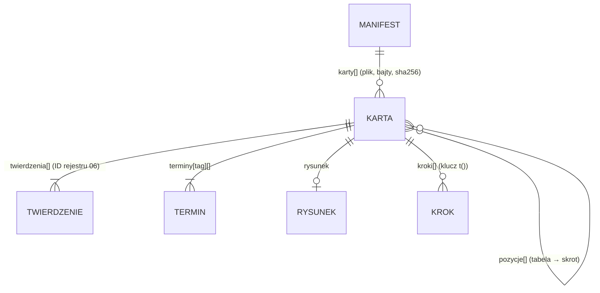

# Atlas technik 1.1 — rola 05, build, E2 (moduły, dane, konfiguracja) · 2026-10-26

Wejście: STOP E1 (`docs/atlas/e1-decyzje.md`), P-207: E1-Q1a (najpierw walidator i schemat, fazy z drutem, glify cyfr, potem strona z testem hreflang), E1-Q2 (nabieranie po danych 06); estetyki nie poprawiać — oceni 04. Pytania 06 w `kontrakt-krokow.md` (sekcja „Pytania 06”) i odpowiedź 06 na Z-06-01.

## 1. Granice modułów (stan docelowy 1.1; dziś kod w `scripts/atlas/`, bo 1.0 jest w budowie)

```
src/domena/atlas/            czysty TS, bez frameworka i I/O (zasada architekta 6); przenosi 08 przy starcie 1.1
  geometria.ts               punkty, Bézier, Catmull-Rom, przecięcia łamanych
  typy.ts                    Karta, Krok, Operacja, Rysunek
  siatka-petli.ts            rodzina „siatka-petli”: model rysunku, reguły przeplotu, drut, strzałka, numer kroku
  kontrakt.ts                SCHEMAT (JSON Schema), walidator struktury i semantyki; rysunek przez wstrzykniętą funkcję
  katalog.ts                 manifest, wczytanie z portami, wybór języka (przełącznik Q3)
src/dane/atlas/ (08)         adapter katalogu: odczyt plików z paczki (expo-file-system), SHA-256 (expo-crypto), UTF-8
src/komponenty/atlas/ (08)   rysunek z modelu przez react-native-svg (ADR-0024), podpis i kroki przez t()
scripts/atlas/               generator i narzędzia (Node): svg.ts (zapis SVG, strażnik liter, glify cyfr), sprawdz.ts (testy geometrii),
                             strona.ts (strona statyczna), generuj.mjs, waliduj.mjs, strona.mjs, testy *.test.ts
```

Kierunek zależności: `komponenty`/`dane` → `domena/atlas`; `scripts/atlas` → `domena/atlas`; domena nie importuje SVG ani strony (walidator dostaje sprawdzenie rysunku jako funkcję `sprawdzKrok`). **Dowód:** symulacja układu (5 plików domeny w `domena/atlas`, 3 pliki generatora obok) — `node docs/architektura/narzedzia/granice.mjs <sym>/src domena 20` → „OK: 8 plików, bez naruszeń”, kod 0; największy plik 15,5 KB (`siatka-petli.ts`).

### Porty (sygnatury; implementacja 08)

```ts
// domena/atlas/katalog.ts
interface PortyKatalogu {
  czytaj(plik: string): Uint8Array | null;   // adapter: plik z paczki aplikacji; null = brak
  sha256(bajty: Uint8Array): string;         // adapter: expo-crypto (szesnastkowo, małe litery)
  dekoduj(bajty: Uint8Array): string;        // UTF-8
}
wczytajKatalog(manifestTekst: string, porty: PortyKatalogu): { karty: Karta[]; bledy: BladKontraktu[]; odrzucony: boolean }
jezykKarty(karta: Karta, jezykUzytkownika: string, polityka: 'angielski' | 'ukryj'): string | null
// domena/atlas/siatka-petli.ts
siatkaPetli(karta: Karta, krok: Krok): Rysunek      // model: części nitki, skrzyżowania z częścią „nad”, strzałka, numer kroku
```

Maszyn stanów brak (atlas nie ma procesu w czasie).

## 2. Dane (bez bazy — moduł `pakiety-tresci`, ARCH-22)

| Wymóg | Rozwiązanie | Dowód |
|---|---|---|
| Format z wersją | karta: `format: 1`; manifest `atlas.json`: `format: 1`, `wersja`, `karty [{plik, bajty, sha256}]` | `kontrakt-krokow.md` „Katalog”; `docs/atlas/katalog.schema.json` |
| Odrzucenie nowszej wersji | manifest nowszy → cały katalog odrzucony, aplikacja zostaje przy treści z paczki; karta nowsza → pominięta | testy „manifest nowszego formatu”, „karta nowszego formatu pominięta” |
| Integralność | SHA-256 z bajtów pliku przed parsowaniem; rozmiar; nazwa pliku bez ukośników | testy `skrot`, `rozmiar`, `../dane.json` |
| Migracja zapisanego formatu | brak zapisu: katalog tylko do odczytu, w paczce; nowy format = nowe wydanie z nowym kodem (ADR-0021) | — (nazwane: nie dotyczy) |
| Zapis atomowy | nie dotyczy: atlas nie zapisuje (ADR-0025 (1)); gdyby powstał pakiet pobierany — instalacja atomowa wg modułu `pakiety-tresci` (nowy ADR) | — |
| Oddzielenie od danych użytkownika | katalog poza bazą SQLite 1.0 (ADR-0001 bez zmian); brak tabel i migracji | `grep -rn atlas src/dane` = 0 dziś; kontrola przy wdrożeniu (07) |

Model danych (ERD w sensie kontraktu, bez tabel):



## 3. Założenia silnika (nazwane, zasada wspólna 7)

| ID | Założenie | Dlaczego nie twierdzenie | Kontrola |
|---|---|---|---|
| A-1 | Nowa pętla przechodzi przez starą przeciwnie do wkłucia: wkłucie `od_przodu` → oczko prawe (nóżki nowej pętli nad głową starej), `od_tylu` → oczko lewe | 06: żadne przeczytane źródło nie mówi tego zdaniem; źródła mówią o wkłuciu (ATL-K-001, ATL-K-005) i „pull it through” (ATL-K-002, ATL-K-006) | test: twierdzenie `kierunek` niezgodne ze `strona` operacji → `twierdzenie` (mutant „od_tylu przy pętli prawej”) |
| A-2 | Przy ujęciu dolna część nowej pętli leży po drugiej stronie wszystkich ujmowanych pętli niż część nad przejściem | wniosek geometryczny z A-1 dla kilku pętli | test „przeplot” na k2tog |
| A-3 | Wymiary pętli (`WYMIAR`) to uproszczenie ilustracyjne bez liczb na rysunku | rysunek nie uczy proporcji | tabela obszaru poprawnego (E1 §2), wygląd: 04 (Z-04-02) |

## 4. Konfiguracja (jedna lista)

| Nazwa (jednostka) | Wartość | Źródło / ID decyzji | Miejsce (1.1) |
|---|---|---|---|
| `ATLAS_JEZYK_BEZ_ZRODLA` (wybór) | `'angielski'` (domyślnie) / `'ukryj'` | Q3, P-201 — **decyzja właściciela** | `src/konfiguracja.ts` |
| `ATLAS_ADRES` (URL https z „/”) | `[DO USTALENIA]` | Q2, P-093 D4 — właściciel | konfiguracja generatora strony |
| `ATLAS_SKLEP` (URL) | `[DO USTALENIA]` | rola 10 (ID aplikacji) | jw. |
| `FORMAT_KARTY`, `FORMAT_KATALOGU` (liczba) | 1, 1 | ADR-0023, ADR-0025 | `domena/atlas` |
| `WYMIAR.*` (jednostki rysunku, mnożniki) | `siatka-petli.ts` | ilustracja (A-3); zakres poprawny E1 §2 | rodzina (jedno miejsce na rodzinę) |
| `KRESKA.*` (jednostki rysunku) | nitka 2,6; obwódka 4,6; wyróżnienie 7,5; drut 3,6; strzałka 1,3; promień łatki 3,0–4,5 | propozycja techniczna; wygląd: 04 (Z-04-02) | `svg.ts` / komponent 08 |
| kolory | tokeny 04: `papier`, `grafit`, `zakreslacz`, `olowek` (jasny, ciemny) | `docs/design/tokeny.json` | motyw |

Liczb dziedzinowych (bilans, pochylenie, kierunek) nie ma w konfiguracji: przychodzą z twierdzeń 06 w karcie albo z operacji.

## 5. Ścieżki utraty danych

| Ścieżka | Ryzyko dla danych użytkownika | Zabezpieczenie | Test |
|---|---|---|---|
| Aktualizacja aplikacji z nowym katalogiem | brak: atlas nie zapisuje | katalog w paczce, bez migracji | — |
| Uszkodzony / nowszy plik katalogu | brak utraty; ryzyko pustego ekranu | karta pominięta, reszta działa; manifest nowszy → treść z paczki; stan „brak karty” — projekt 04 | testy manifestu (6) |
| Wspólna baza z 1.0 | brak: katalog poza SQLite | ADR-0025 (1) | kontrola 07 przy wdrożeniu: atlas nie importuje `src/dane/baza` |
| Kopia / przeniesienie na nowy telefon | nie dotyczy (treść z paczki) | — | — |
| „Ostatnio oglądane” / ulubione karty | poza zakresem 1.1 (brak przepływu w kontrakcie) | gdyby weszło: nowy ADR i tabela w bazie 1.0 z migracją | — |

## 6. Dowody E2 (2026-10-26)

- `npx jest scripts/atlas` → **86/86** (2 zestawy): `silnik.test.ts` 37 (5 rysunków bez błędów, 5 × determinizm, k2tog, odwrócenie reguły prawe/lewe, wkłucie: 2 skrzyżowania na pętlę, raz nad, raz pod; **13 mutantów**, każdy oblewa właściwe sprawdzenie; strzałka; glify cyfr; 7 przypadków strażnika liter), `kontrakt.test.ts` 49 (schemat w repo = kod; karty próbne; **24 przypadki negatywne walidatora**, każdy z oczekiwanym kodem; ścieżka pola; manifest 8; przełącznik języka 6; strona 7: zestaw stron, brak stron skrótów i języków spoza `jezyki_gotowe`, hreflang z symetrią i x-default, strażnik liter i `lang`, mapa strony, brak tekstu → błąd bez plików, brak adresu → błąd).
- `node --experimental-strip-types --no-warnings scripts/atlas/waliduj.mjs docs/atlas/prototyp/karty` → „OK: 3 kart bez błędów”; `--schema --check` kod 0.
- `generuj.mjs --check` → „OK: 5 rysunków bez błędów”; rozmiary SVG 13,7–27,3 KB (łatki próbkowane 32 punktami na część; przy 96 było 23–57 KB).
- Niezależna kontrola schematu: biblioteka JSON Schema obecna w `node_modules` jako zależność narzędzia lint (ajv 6, draft-07) i własny walidator dają ten sam wynik — 3 karty przyjęte, 30/30 mutantów odrzuconych (`docs/atlas/eksperymenty/ajv-porownanie.cjs`; eksperyment, nie część `verify`).
- Strona: `strona.mjs` na kartach próbnych → 6 plików; bez `--adres` → kod 1, nic nie zapisano; render w motywie ciemnym (Playwright, `colorScheme: dark`) — kolory rysunku z klas ról podmienione.
- `npx tsc -p tsconfig.testy.json` kod 0.

### Co E2 wykazało i zmieniło w silniku
1. **Globalna kolejność warstw nie wystarcza** (drut przechodzi raz nad, raz pod tą samą głową → cykl). Rysowanie zmienione na łatki przeplotu: warstwa bazowa + na każdym skrzyżowaniu odcinek części „nad”; kolejność łatek z lokalnych zależności, cykl = „skrzyżowania za blisko”. Sprawdzenie liczy regułę od nowa i weryfikuje, czyja łatka leży ostatnia w punkcie skrzyżowania.
2. Nowe sprawdzenie złapało realne zasłanianie na brzegu próbki oczka lewego (skrzyżowania 5,9 j. od siebie przy promieniu łatki 4,5) — promień łatki zależny od odstępu, min. 3,0.
3. Numer kroku ustalany po kluczu kroku (wcześniej po tożsamości obiektu — kopia kroku gubiła numer; test determinizmu to wykrył).

## 7. Zgłoszenia

| ID | Do | Treść |
|---|---|---|
| Z-06-02 | 06 | `drut.grot` w k2tog (`w_lewo`) bez twierdzenia — potrzebne zdanie ze źródła o kierunku drutu przy wkłuciu albo decyzja, że rysunek pokazuje tylko „przez pętlę” bez kierunku grotu (wtedy pole opcjonalne w formacie 2) |
| Z-06-03 | 06 | ID kart próbnych zmienione na ID 06 (`druty.oczko.k`, `druty.oczko.p`); `terminy` jako lista; `null` w `wartosc` niedozwolone — pomijać pole |
| Z-04-03 | 04 | Strona atlasu: wygląd (kroje, odstępy, kolor odnośników) to dziś minimum techniczne; rysunek 100% szerokości do 32 rem |
| Z-07-01 | 07 | Testy `scripts/atlas/*.test.ts` w `npm test` (Jest zbiera je bez zmiany `package.json`); `tsconfig.testy.json` obejmuje `scripts/atlas`; przy przeniesieniu do `src/domena/atlas` (08) — `granice.mjs src` |
| Z-08-01 | 08 (1.1) | Przeniesienie wg §1; importy bez rozszerzenia `.ts`; `react-native-svg` wg ADR-0024 i szkicu w ADR-0016; adaptery portów katalogu |

## 8. Pytanie na STOP E2 (koordynator wg P-087)

**E2-Q1. Karta szydełkowa dla języka, w którym jest tylko inny wariant regionalny (np. użytkownik en-GB, karta tylko en-US).** Przy przełączniku `angielski` aplikacja pokaże terminy US, a w szydełku „dc” znaczy w US i UK co innego (RYZ-03).
- (a) Dla kart `rzemioslo: szydelko` brak dokładnego wariantu → jak `ukryj`, niezależnie od przełącznika; druty według przełącznika.
- (b) Zawsze według przełącznika, z widoczną informacją o wariancie (projekt 04).
- **Rekomendacja: (a)** — błędny termin psuje robótkę, a sprawa jest merytoryczna (hierarchia źródeł), nie tylko produktowa; koszt: mniej kart szydełkowych dla en-GB, dopóki 06 nie da terminów UK.
